# Bibliothèque de circuits — bending électromagnétique (boîte son ↔ gant ou baguette)

Circuits à tester au parc. **Aucun contact électrique** entre deux parties :

- **La boîte son (S)** produit le son. Elle a une ou plusieurs « oreilles magnétiques ».
- **Le modulateur** est un **gant (G)** ou une **baguette (B)**. Il peut être **passif**
  (aimants, ferrite, résonateurs : sans pile, robuste) ou **actif** (une bobine émet un champ).

C'est du circuit bending dans lequel le doigt n'est plus un fil : c'est un champ.

> **État : aucun de ces circuits n'a encore été monté.** Chaque schéma a passé l'ERC KiCad, et
> sa netlist exportée a été comparée automatiquement à la netlist voulue. Le câblage dessiné est
> donc celui qui est décrit, mais les **valeurs sont des points de départ à mesurer sur plaque
> d'essai**, puis au parc.

Sommaire : [Physique](#0-physique-utile-trois-canaux) · [Gants](#1-les-gants-g) ·
[Baguette](#2-la-baguette-b--un-seul-objet-plusieurs-modes-de-jeu) · [Ampli commun](#s0--ampli-de-sortie-commun) ·
[Circuits son](#3-les-circuits-son-s) · [Inductances et transformateurs](#4-inductances-et-petits-transformateurs) ·
[Matrice](#5-matrice-modulateur--circuit) · [Prototypage](#6-ordre-de-prototypage-suggéré) ·
[Protocole](#7-protocole-de-test-au-parc) · [Sécurité](#8-sécurité-et-contraintes-de-site) ·
[Références](#9-références-à-rassembler-dans-refs) · [Régénérer](#10-régénérer-les-schémas)

---

## 0. Physique utile (trois canaux)

| Canal | Le modulateur porte | La boîte capte avec | Ce qui est mesuré |
|---|---|---|---|
| **Champ statique** | aimant néodyme, ou électroaimant en continu | capteur à effet Hall, ILS (reed), magnétomètre, saturation d'une ferrite | distance, polarité N/S |
| **Induction** (flux variable) | aimant **en mouvement**, ou bobine alimentée | bobine captrice | vitesse (aimant), signal émis (bobine) |
| **Perturbation d'inductance** | ferrite, acier, cuivre/alu, circuit LC accordé | oscillateur LC | proximité, matière, accord |

- **Portée** : le champ d'un dipôle décroît en **1/r³**. À distance double, le champ est 8 fois
  plus faible. On peut compter sur une portée utile de 1 à 10 cm : le geste naturel est de
  « presque toucher », et la surface de la boîte doit montrer où sont les zones sensibles.
- **Matière ↔ sens de variation** (oscillateur LC à noyau de ferrite) : une ferrite ou de l'acier
  **augmentent** L (la fréquence baisse) ; le cuivre ou l'alu (courants de Foucault) **diminuent**
  L (la fréquence monte) ; un aimant fort **sature** la ferrite et diminue L (la fréquence monte).
- **Bruit ambiant** : une bobine captrice entend le 50 Hz, les téléphones et les alimentations à
  découpage. On peut s'en servir comme matériau sonore (*Electrical Walks* de Kubisch), mais il
  faut le savoir avant de tester.

---

## 1. Les gants (G)

| Id | Gant | Alim. | Ce qu'il porte | Commentaire |
|---|---|---|---|---|
| **G1** | Aimants | aucune | disques néodyme (≈ 6–10 mm) au bout des doigts, **polarités différentes** selon le doigt | Le plus simple. Avec un Hall, le pôle N et le pôle S font varier la sortie dans des sens opposés. |
| **G2** | Ferreux | aucune | perles ou plaquettes de ferrite, rondelles d'acier, plaque de cuivre sur la paume | Sans aimant, donc plus sûr. Agit sur les oscillateurs LC (S4, S8, S11, S12). |
| **G3** | Résonateurs LC | aucune | une bobine et une capacité C0G par doigt, chacune accordée sur sa propre fréquence | Gant passif mais **sélectif** (voir S7). Le **Velostat** en parallèle donne de l'expression sans pile. |
| **G4** | Bobine émettrice | pile 9 V | bobine dans la paume, pilotée par un NE555 et un MOSFET ; un capteur de flexion règle la hauteur | Le champ porte un signal audio. |
| **G5** | Bobine émettrice pilotée par MCU | LiPo | même électronique que la baguette B2 | Programmable. Voir B2. |

### G3 — Résonateur passif de doigt

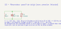

### G4 — Gant émetteur

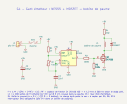

---

## 2. La baguette (B) : un seul objet, plusieurs modes de jeu

Le gant oblige à choisir à l'avance ce qu'on porte sur chaque doigt. La baguette **change de
mode de jeu** d'un geste. Elle se tient dans la main, se passe facilement d'une personne à
l'autre, et sa pointe désigne nettement la zone sensible de la boîte. Deux variantes :

### B1 — Baguette passive « revolver » (sans électronique)

Une tête en bout de baguette tourne par crans. Chaque face présente une matière différente à la
boîte :

| Cran | Face présentée | Agit sur |
|---|---|---|
| 1 | aimant néodyme, pôle N | S1 S2 S3 S9 S10 |
| 2 | même aimant retourné, pôle S | S2 S3 S10 (sens inverse) |
| 3 | barreau de ferrite | S4 S8 S11 S12 |
| 4 | pastille de cuivre | S4 (fréquence vers le haut) |
| 5 | résonateur LC (comme G3) | S7 |

L'aimant est **noyé dans la tête** (résine) : aucune pièce aimantée ne peut se détacher. Un
**fourreau en acier doux** coulissant (comme sur les bases magnétiques d'atelier) « éteint »
l'aimant en refermant son flux, quand on veut jouer seulement la ferrite ou le cuivre.

### B2 — Baguette active multi-mode (électroaimant piloté)

Une seule bobine sur noyau de ferrite, en pointe de baguette, fait tous les modes. Un
**sélecteur rotatif à 2 pôles × 6 positions** choisit à quoi elle est branchée :

| Position | Mode | La bobine est… | Agit sur |
|:-:|---|---|---|
| 1 | **Aimant** | alimentée en continu par le pont en H, sens et force par PWM (N ou S) | S1 S2 S3 S10 |
| 2 | **Émetteur** | alimentée en audio (synthèse sur la XIAO) | S5 S6 S8 S13 |
| 3 | **Impulsions** | alimentée par rafales | S9 |
| 4 | **Résonateur f1** | fermée sur C3, pont en veille | S7 (canal 1) |
| 5 | **Résonateur f2** | fermée sur C4, pont en veille | S7 (canal 2) |
| 6 | **Ferrite** | en l'air, seul le noyau agit | S4 S8 S11 S12 |

Le second pôle du sélecteur indique la position à la XIAO, par une échelle de résistances lue
sur une entrée analogique. Le logiciel suit donc toujours le mode mécanique. En positions 4 à 6,
le pont est mis en veille et ses sorties passent en haute impédance. Une centrale inertielle
(IMU) transforme l'inclinaison et la vitesse du geste en intensité et en hauteur, et un bouton
déclenche.

Un électroaimant de cette taille est **moins fort qu'un aimant néodyme** : pour S1 (ILS), il faut
s'attendre à une portée plus courte qu'avec B1. À mesurer avant d'arrêter le choix.

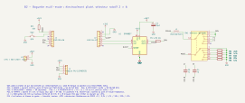

---

## S0 — Ampli de sortie commun

Toutes les boîtes son sortent sur l'entrée J1 de ce module. Le limiteur à diodes plafonne le
niveau quoi qu'on branche en entrée : on est dans un espace public.

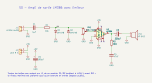

---

## 3. Les circuits son (S)

### S1 — Reed-bend : les fils de bend remplacés par des ILS

Sur une Atari Punk Console (deux NE555, F. Mims), trois contacts ILS remplacent des fils de bend.
Un ILS de travail **ajoute** un bend, un ILS de repos le **coupe**. Utiliser des contacts
d'ouverture d'alarme (surmoulés, étanches) plutôt que des ampoules de verre nues. Portée
attendue avec un disque de 10 mm : 1 à 3 cm, à mesurer.

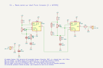

### S2 — « MagPot » : un potentiomètre magnétique isolé

Capteur à effet Hall DRV5055A2 (≈ 50 mV/mT à 5 V, ± 42 mT), puis ampli de gain ≈ 5,7 autour d'un
zéro réglable, puis la LED d'un vactrol. La **LDR** remplace un potentiomètre ou un point de bend
variable dans n'importe quel circuit, avec une isolation galvanique totale. Le retard de la LDR
(10 à 100 ms) donne des glissés naturels. C'est un module générique, à fabriquer en série.

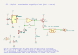

### S3 — Hall → VCO

Même étage d'entrée que S2, qui pilote cette fois le VCO d'un CD4046. Le pôle N et le pôle S font
varier la hauteur dans des sens opposés.

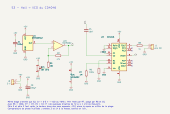

### S4 — Battement de deux oscillateurs LC (BFO)

Deux oscillateurs LC CMOS à ≈ 260 kHz. Celui de détection utilise une **antenne ferrite récupérée
sur une vieille radio AM**. Le XOR et le filtre RC ne gardent que la différence de fréquence, qui
est audible. Un écart de 1 % sur 260 kHz donne déjà 2,6 kHz. Les trois matières de G2 font varier
la hauteur dans trois sens. La dérive thermique (soleil) impose un trimmer d'accord accessible.

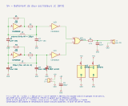

### S5 — Bobine captrice → modulation d'un oscillateur

La bobine captrice passe par un **transfo élévateur** (voir §4), puis un préampli de gain ≈ 100,
puis module la charge du condensateur de timing d'un oscillateur 40106 (FM). Quand la fréquence
émise par G4 ou B2 s'approche de celle de l'oscillateur, on obtient des battements puis un
**verrouillage**. C'est la zone intéressante.

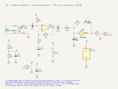

### S6 — Bending par couplage : des bobines sur les points de bend

Sur chaque nœud à haute impédance du circuit hôte, une cellule **self – résistance –
condensateur** devient un « point de bend magnétique ». Le gant émetteur y injecte son signal :
glitchs, verrouillages, bits qui sautent. Rayonner sur un PCB nu ne marche pas, il faut une
bobine par nœud. La même cellule se soude sur n'importe quel jouet.

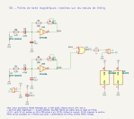

### S7 — Absorption (grid-dip), le partenaire de G3 et de B2 en mode résonateur

Un oscillateur de Clapp à ≈ 150 kHz, réglé juste au-dessus du seuil d'oscillation. Un résonateur
accordé sur sa fréquence lui **prend de l'énergie** : l'amplitude chute, et la tension détectée
(CV) aussi. Un oscillateur par canal (écart d'au moins ±20 %), un résonateur accordé par doigt.

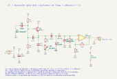

### S8 — Larsen magnétique : le modulateur fait le pont

Une bobine émettrice alimentée par la sortie de l'ampli et une bobine captrice sont placées sans
couplage au repos. Une barre de ferrite ou une plaque d'acier referme le flux, et le larsen
naît. Très spectaculaire, avec un modulateur passif. **Limiteur obligatoire.**

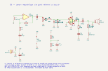

### S9 — Dynamo : la vitesse du geste

Une bobine à beaucoup de spires (bobine de relais, solénoïde, plus de 1000 spires sur noyau de
fer) produit une impulsion proportionnelle à la **vitesse** quand on passe un aimant devant.
C'est exactement la chaîne de `hp-capteur` (préampli → enveloppe → ADC de la XIAO) : on
**remplace le haut-parleur LS1 par la bobine**, sans rien changer d'autre. Un geste immobile ne
produit rien, seul le mouvement sonne.

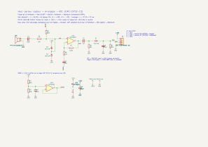

### S10 — Voie numérique (contrôle maximal, mais moins « bending »)

Un module magnétomètre I²C (LIS3MDL ou MLX90393) lit la position 3D d'un aimant. La XIAO
ESP32-C3 fait la synthèse et sort en PWM, filtré avant S0. Ce montage sert aussi
d'**instrument de mesure** pour comparer les portées des autres circuits.

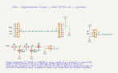

---

## 4. Inductances et petits transformateurs

Les composants bobinés sont à la fois **capteurs** et **éléments du son** : un aimant ou une
ferrite qui s'approche change leur inductance, et le son change directement. On les trouve dans
les radios à transistors, les pédales et les jouets.

| Composant | Où le trouver | Rôle ici |
|---|---|---|
| Antenne ferrite AM (≈ 200–600 µH) | radio AM récupérée | capteur du BFO (S4) |
| Self axiale 10 mH, self à tambour 100 mH | composant courant | point de bend magnétique (S6), wah (S12) |
| Inductance de wah 500 mH (pot ferrite) | pièce détachée de pédale | wah magnétique (S12) |
| Transfo de sortie 1 kΩ PM : 8 Ω | radio à transistors | élévateur de bobine captrice (S5), oscillateur Hartley (S11) |
| Transfo audio 600 Ω : 600 Ω PM | petit transfo de ligne | modulateur en anneau (S13) |
| Bobine de relais, solénoïde | relais 12 V récupéré | dynamo (S9) |
| Bobine téléphonique à ventouse | magasin d'électronique | captrice basse impédance (S5, S8) |

**Transfo élévateur** (déjà dans S5) : monté à l'envers, le côté 8 Ω vers la bobine captrice, un
transfo de sortie élève la tension d'environ ×11 **sans ajouter de bruit**, avant le préampli.
C'est la façon classique d'adapter une bobine basse impédance.

### S11 — Oscillateur Hartley sur petit transfo

Le primaire à point milieu d'un transfo de sortie et C1 forment le circuit accordé, et le
secondaire 8 Ω attaque directement le haut-parleur. Un aimant contre le noyau feuilleté le
sature : l'inductance baisse et la hauteur monte. Le noyau capte aussi le champ de G4. R1 et C2
sont à ajuster sur plaque d'essai selon le transfo.

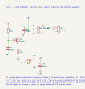

### S12 — Wah magnétique

Un signal carré riche en harmoniques traverse un circuit LC parallèle (inductance de wah
500 mH, 100 nF, résonance ≈ 710 Hz). Un aimant près du noyau fait monter la résonance : on
obtient un balayage de wah sans pédale. Le pied du circuit accordé est à VB, pour qu'aucun
courant continu ne pré-aimante l'inductance.

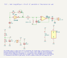

### S13 — Modulateur en anneau à deux transformateurs

C'est le modulateur en anneau classique (deux transfos à point milieu et quatre diodes
Schottky). La porteuse vient d'un oscillateur 40106. Le signal modulant est celui du gant
émetteur, capté et préamplifié par S5. On entend le gant **multiplié** par la porteuse.

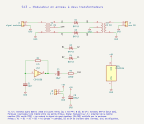

---

## 5. Matrice modulateur × circuit

● = couple principal · ○ = fonctionne ou à essayer · — = sans effet

| | G1 aimants | G2 ferreux | G3 LC | G4 émetteur | B1 revolver | B2 multi-mode |
|---|:-:|:-:|:-:|:-:|:-:|:-:|
| S1 Reed-bend | ● | — | — | — | ● | ○ pos. 1 (portée réduite) |
| S2 MagPot | ● | ○ (Hall polarisé) | — | — | ● | ● pos. 1 |
| S3 Hall → VCO | ● | ○ | — | — | ● | ● pos. 1 |
| S4 BFO | ○ (saturation) | ● | ○ | ○ | ● | ● pos. 6 |
| S5 Captrice → FM | ○ (mouvement) | — | — | ● | — | ● pos. 2 |
| S6 Bobines sur nœuds | — | — | — | ● | — | ● pos. 2 |
| S7 Absorption | — | ○ | ● | — | ● | ● pos. 4–5 |
| S8 Larsen | — | ● | ○ | ○ | ● | ● pos. 6 |
| S9 Dynamo | ● | — | — | ○ | ● | ● pos. 3 |
| S10 Numérique | ● | — | — | — | ● | ● pos. 1 |
| S11 Hartley transfo | ● | ○ | — | ○ | ● | ○ pos. 1, 2 |
| S12 Wah magnétique | ● | ○ | — | — | ● | ○ pos. 1 |
| S13 Anneau | — | — | — | ● | — | ● pos. 2 |

---

## 6. Ordre de prototypage suggéré

1. **S0** (ampli et limiteur) : tout le reste en dépend.
2. **S1 + G1/B1** sur une Atari Punk Console : une soirée de travail, et un résultat garanti.
3. **S5 + G4** : émetteur 555 dans le gant, bobine téléphonique et transfo sur un 40106.
4. **S12 et S11** : les deux montages à bobinages les plus simples, pour mesurer la réaction des
   noyaux à un aimant.
5. **S4 + G2** : BFO sur antenne ferrite récupérée, test des trois matières.
6. **S2 MagPot** en série, greffé sur les hôtes de S1.
7. **B2**, une fois les portées mesurées : on saura quels modes valent la peine.
8. **S7 + G3**, le plus délicat à accorder. **S8** seulement quand le limiteur est validé.

---

## 7. Protocole de test au parc (par couple circuit × modulateur)

- **Portée** : mesurer à la règle la distance du premier effet audible et celle de l'effet
  maximal. Noter l'orientation (le champ d'un dipôle est directionnel). S10 peut servir de
  référence de mesure.
- **Dérive** : réécouter S4, S7 et S11 après 30 minutes au soleil, et noter les retouches
  d'accord.
- **Bruit** : écouter S5, S6, S8 et S13 sans modulateur, près et loin des lampadaires et des
  câbles enterrés.
- **Lisibilité** : un passant comprend-il le geste sans explication ? Noter combien de temps il
  met. Comparer le gant et la baguette.
- **Enregistrer** chaque essai avec le n° du couple, le mode de la baguette, la distance et la
  météo.

---

## 8. Sécurité et contraintes de site

- **Néodyme** : deux aimants avalés s'attirent à travers l'intestin, ce qui est une urgence
  chirurgicale. Ils doivent être **scellés** (résine, couture, silicone), sans aucune pièce libre.
  Ils pincent aussi les doigts.
- **Stimulateurs cardiaques et défibrillateurs implantés** : garder les aimants et
  l'électroaimant de B2 à plus de 15 cm, et **afficher un panneau** aux postes concernés.
- **Volume** : limiteur S0 sur toutes les sorties, niveau plafonné. Le public comprend des
  enfants, et il y a des riverains.
- **Alimentation** : uniquement en basse tension sur batterie (LiPo protégée, ou pile 9 V),
  **jamais le secteur**.
- **Émission** : rester en champ proche, à faible puissance, en audio ou en LF (< 500 kHz). C'est
  le même principe que les boucles magnétiques pour malentendants. Pas d'émetteur RF.
- **Météo et vandalisme** : boîtiers IP, ILS surmoulés, modulateurs passifs (G1–G3, B1) de
  préférence pour l'usage libre.

---

## 9. Références à rassembler dans `refs/`

- Nicolas Collins, *Handmade Electronic Music* (Routledge) : bobines captrices, induction,
  feedback. Sa version libre antérieure, *Hardware Hacking*.
- Reed Ghazala, *Circuit-Bending: Build Your Own Alien Instruments* (2005).
- Forrest Mims, *Engineer's Mini-Notebook: 555 Timer IC Circuits*, « Stepped Tone Generator »
  (= Atari Punk Console, S1).
- Christina Kubisch, *Electrical Walks* : casques à induction.
- Fiches techniques : DRV5055, DRV8837, LIS3MDL, MLX90393, LSM6DS3, NSL-32, CD4046, CD40106,
  CD4069UB, CD4070, NE555, LM386, MCP6002, LM358.
- Schémas de détecteurs de métaux BFO et de thérémines BFO (S4) ; schémas de pédales wah (S12) ;
  modulateurs en anneau à diodes (S13).
- Pistes voisines : l'EBow et le *Magnetic Resonator Piano* d'A. McPherson.

---

## 10. Régénérer les schémas

Les schémas KiCad (`schemas/*.kicad_sch`) et leurs SVG sont **générés** par `circuits.py` (une
fonction par circuit) via `kischem.py`, qui réutilise `../hp-capteur/kisexpr.py`. Pour modifier
un circuit, éditer `circuits.py` puis relancer :

```sh
python3 -I circuits.py            # tous les schémas
python3 -I circuits.py S4_bfo     # un seul
```

Le générateur nécessite KiCad 9 (`kicad-cli`) et `rsvg-convert` pour les aperçus. Pour chaque
schéma, il lance l'ERC et **compare la netlist exportée à la netlist voulue**. Toute fusion
accidentelle de deux nets fait échouer la génération. Les fichiers `.kicad_sch` s'ouvrent dans
KiCad pour être retouchés à la main, mais une retouche manuelle sera écrasée à la prochaine
génération.
